# GraphGuard: Temporal Graph Intelligence for Financial Crime Detection

[](backend/tests/)
[](frontend/)
[](backend/)
[](LICENSE)

> **Research Question:** Does incorporating transaction relationships and temporal graph evolution improve the detection of illicit cryptocurrency transactions compared with conventional tree ensembles?
>
> **Empirical Answer:** **No.** On the leak-free chronological benchmark (`paper_refit`), tabular **XGBoost achieves 0.8001 ± 0.0009 PR-AUC**, significantly outperforming static **Graph Convolutional Networks (0.6384 ± 0.0111 PR-AUC)**, with a paired time-step block-bootstrap 95% confidence interval strictly excluding zero ($\Delta = +0.1491$, 95% CI `[+0.0904, +0.2384]`). Temporal weight evolution (**EvolveGCN-O**) further degrades performance (`0.2211 ± 0.0530`), while freezing recurrent weights restores static GCN parity (`0.6348 ± 0.0110`), confirming that recurrent parameter drift across disconnected transaction snapshots harms financial crime detection.

---

## 📸 Interface Showcase

GraphGuard provides an offline research and forensic inspection suite built with **Next.js 14** (App Router, Tailwind CSS, Cytoscape.js, Recharts) and backed by a **FastAPI** inference engine.

### 1. Primary Benchmark & Headline Research Results
Dot-and-whisker visualization displaying PR-AUC means with paired block-bootstrap 95% confidence intervals against the random guessing baseline (`0.065`).

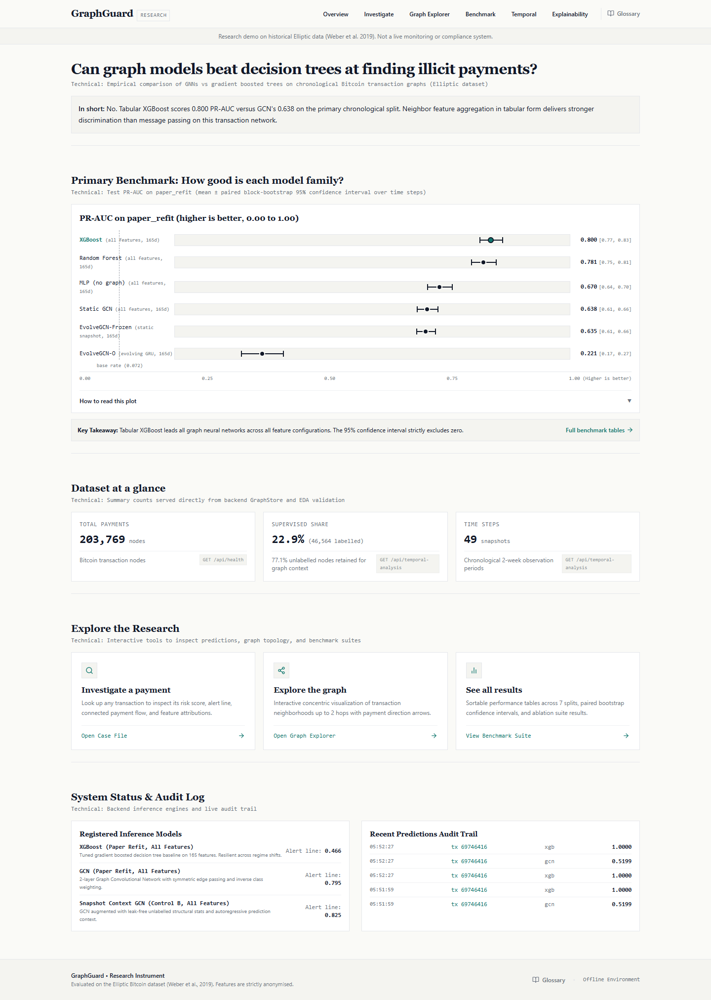

<details>
<summary>📱 Mobile View (390px)</summary>

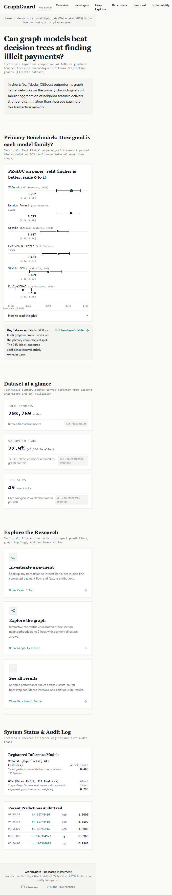
</details>

---

### 2. Scientific Benchmark Suite & Statistical Confidence Intervals
Verbatim performance tables generated from saved predictions across 7 splits, paired statistical hypothesis testing with block-bootstrap CIs, and Precision-Recall / ROC curves.

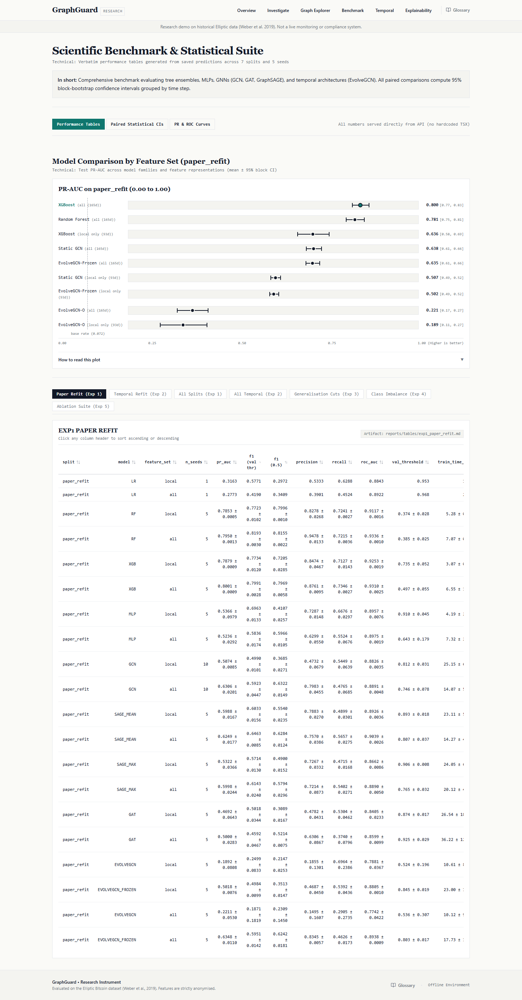

<details>
<summary>📱 Mobile View (390px)</summary>

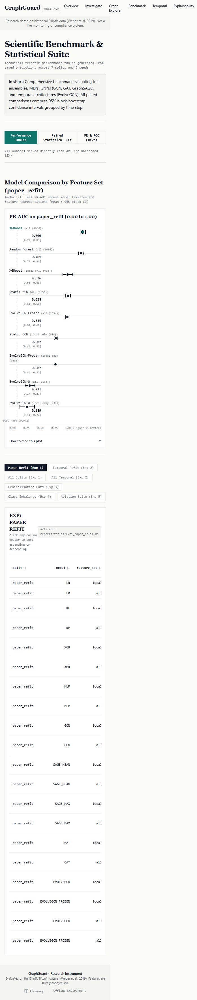
</details>

---

### 3. Temporal Dynamics & Late-Period Regime Shift
Chronological tracking across evaluation time steps (35–49) and forward-chaining cuts (`fc_24` to `fc_44`). Highlights the late-period regime change where illicit transaction counts collapse (<30 per step), inflating evaluation variance.

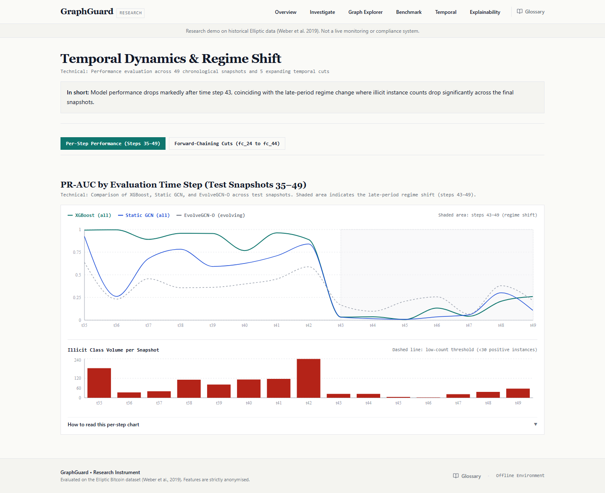

<details>
<summary>📱 Mobile View (390px)</summary>

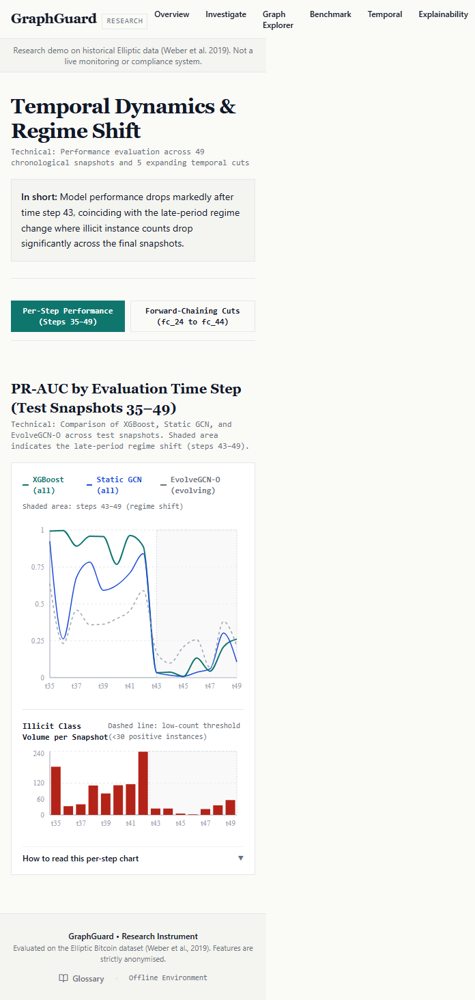
</details>

---

### 4. Multi-Faceted Attribution & Explainability
Global feature importances via TreeExplainer SHAP, local feature contributions, 1-hop neighbor occlusion impact, and topological pattern flags (fan-in, fan-out, peeling chains).

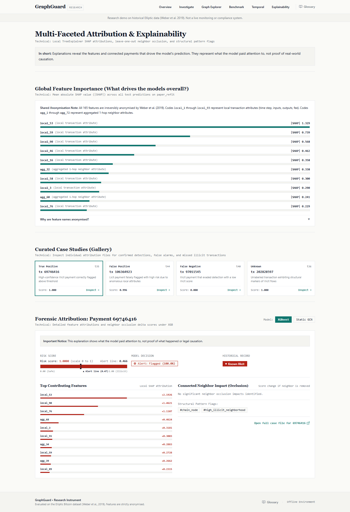

<details>
<summary>📱 Mobile View (390px)</summary>

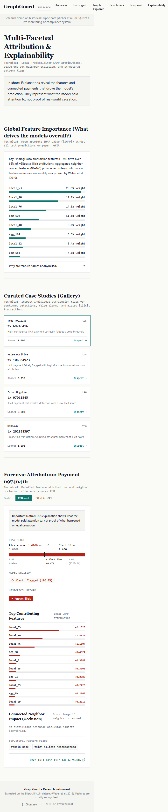
</details>

---

### 5. Interactive Graph Explorer
Interactive Cytoscape.js canvas rendering intra-snapshot 1-hop and 2-hop transaction neighborhoods, directional payment flow edges, and class attributes.

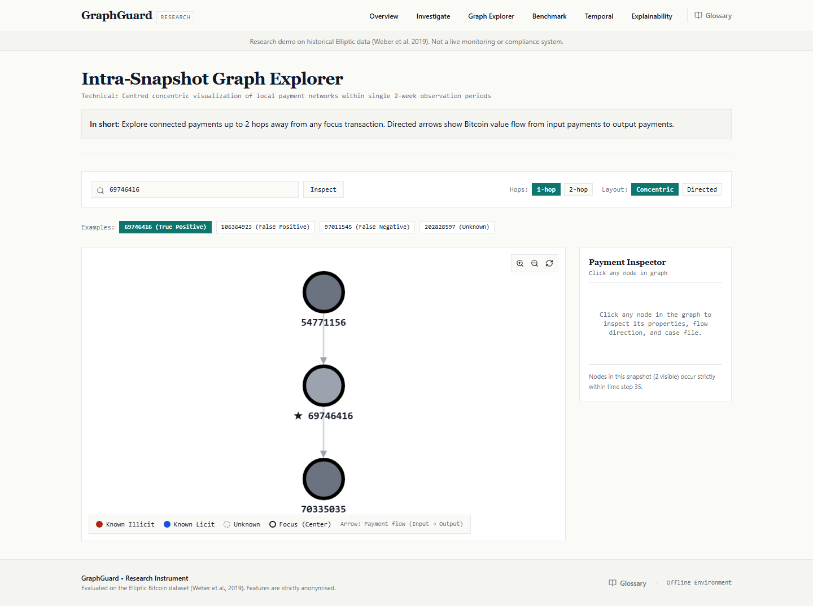

<details>
<summary>📱 Mobile View (390px)</summary>

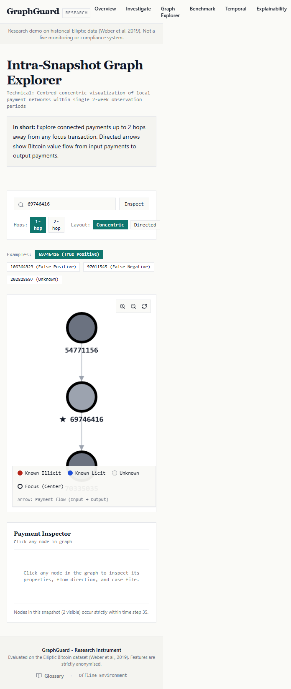
</details>

---

### 6. Forensic Case-File Investigation
Full transaction forensic report: risk score vs alert threshold, topological network graph, top SHAP driver features, and connected peer payment breakdown.

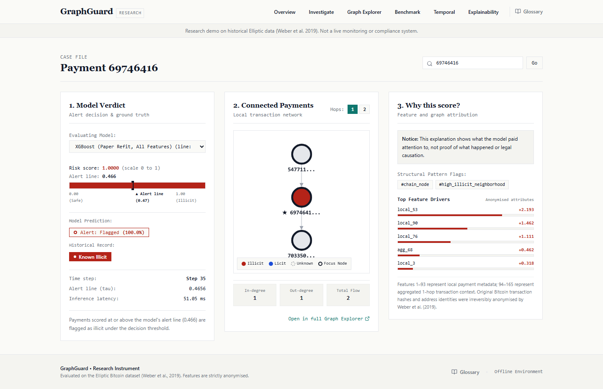

<details>
<summary>📱 Mobile View (390px)</summary>

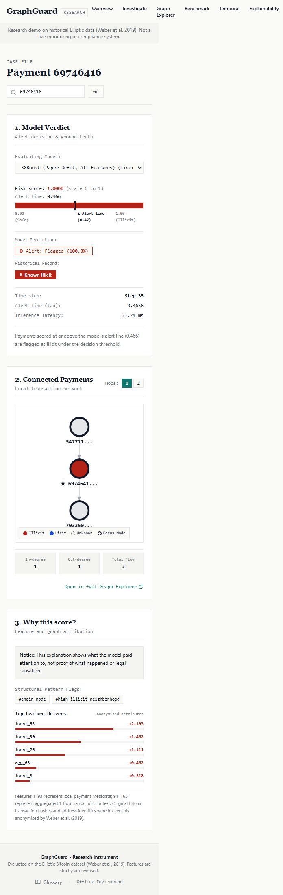
</details>

---

## 📊 Benchmark Findings

All numbers are served directly from saved experiment predictions under `experiments/results/` and verified with paired block-bootstrap hypothesis testing over time steps.

### Primary Benchmark (`paper_refit` Split, All 165 Features)

| Model Family | Architecture Type | Test PR-AUC | Test ROC-AUC | F1 Score (Val Thr) | Inference Latency |
|:---|:---|:---:|:---:|:---:|:---:|
| **XGBoost** | Gradient Boosted Trees | **0.8001 ± 0.0009** | 0.9310 ± 0.0025 | 0.7991 ± 0.0028 | 4.3 µs |
| **Random Forest** | Bagged Decision Trees | 0.7950 ± 0.0013 | 0.9336 ± 0.0010 | 0.8193 ± 0.0030 | 8.7 µs |
| **Static GCN** | 2-Layer Graph Convolution | 0.6384 ± 0.0111 | 0.8912 ± 0.0037 | 0.5905 ± 0.0363 | 0.2 ms |
| **EvolveGCN-Frozen** | Static GCN Snapshot | 0.6348 ± 0.0110 | 0.8938 ± 0.0009 | 0.5951 ± 0.0142 | 0.1 ms |
| **MLP Control** | Multi-Layer Perceptron (No Graph) | 0.5236 ± 0.0292 | 0.8975 ± 0.0019 | 0.5836 ± 0.0174 | 0.1 µs |
| **EvolveGCN-O** | Recurrent Weight Evolution | 0.2211 ± 0.0530 | 0.7742 ± 0.0422 | 0.1871 ± 0.1819 | 0.2 ms |

*Note: Test base rate is **0.065** (1,083 illicit / 16,670 labelled transactions). Random guessing yields PR-AUC ≈ 0.065.*

### Paired Statistical Significance (Block-Bootstrap 95% CIs)

| Comparison | $\Delta$ PR-AUC | Primary 95% Block CI | Significance |
|:---|:---:|:---:|:---|
| **XGBoost vs Static GCN** | **+0.1491** | `[+0.0904, +0.2384]` | **Significant (XGBoost > GCN)** |
| **Static GCN vs EvolveGCN-Frozen** | -0.0067 | `[-0.0223, +0.0106]` | **No Significant Difference (Sanity Gate Holds)** |
| **Static GCN vs EvolveGCN-O** | -0.2094 | `[-0.3054, -0.1209]` | **Significant (Static GCN > EvolveGCN-O)** |
| **XGBoost: Local vs All Features** | +0.0126 | `[+0.0036, +0.0238]` | **Significant (All > Local)** |

---

## 🏛️ System Architecture

```
GraphGuard/
├── ml/                      # Machine learning research pipeline
│   ├── data/                # Integrity checks & dataset validation
│   ├── preprocessing/       # Leakage-safe chronological splits & feature scalers
│   ├── baselines/           # Tabular models (XGBoost, Random Forest, Logistic Regression)
│   ├── gnn/                 # Graph neural networks (GCN, GraphSAGE, GAT)
│   ├── temporal/            # EvolveGCN-O recurrent parameter evolution
│   ├── evaluation/          # Paired block bootstrapping & threshold calibration
│   └── explainability/      # SHAP TreeExplainer & PyG GNNExplainer
├── backend/                 # FastAPI backend server
│   ├── app/                 # Routers, schemas, graph store, & inference engine
│   └── tests/               # Unit and integration test suite
├── frontend/                # Next.js 14 forensic dashboard
│   ├── app/                 # Next.js App Router pages
│   ├── components/          # CIPlot, DataTable, GraphCanvas, ScoreBar
│   ├── scripts/             # Automated test script enforcing zero hardcoded decimals
│   └── lib/                 # Typed API client
├── reports/                 # Formatted markdown tables, JSON stats, & figures
├── docs/                    # Design analysis, audit reviews, & UI screenshots
└── experiments/             # YAML experiment configs & structured output runs
```

---

## 🚀 Quickstart

### 1. Prerequisites & Environment Setup

```bash
git clone https://github.com/BhanuPrakash6640/Graph.git
cd Graph

# Python environment
python -m venv .venv
# Windows: .venv\Scripts\activate    macOS/Linux: source .venv/bin/activate
pip install -r requirements-ml.txt
pip install -e .
```

### 2. Launch FastAPI Backend

```bash
python -m uvicorn backend.app.main:app --host 0.0.0.0 --port 8000
```
*API Swagger documentation available at `http://localhost:8000/docs`.*

### 3. Launch Next.js Dashboard

```bash
cd frontend
npm install
npm run build
npm run start -- -p 3000
```
*Access the dashboard at `http://localhost:3000`.*

---

## 🧪 Testing & Quality Assurance

```bash
# Run backend API tests (11 passed)
pytest backend/tests/

# Run core ML & leakage tests (51 passed)
pytest tests/ -v --ignore=tests/test_data_real.py

# Run frontend linting & rule check (fails on any hardcoded data decimals)
cd frontend
npm run lint
```

---

## 📜 Dataset & Ethics Disclaimer

This repository is an offline academic demonstration using the public **Elliptic Bitcoin dataset** (Weber et al., 2019). It is **not** a production anti-money laundering tool, does not monitor live blockchain activity, and does not process personally identifiable financial data. All 165 features are irreversibly anonymised.
